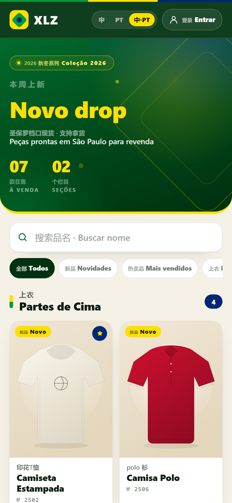
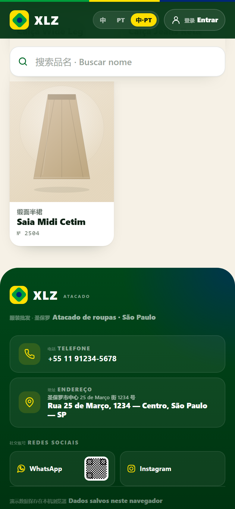

# XLZ 服装档口 · 产品展示

**线上地址：<https://xlz-showcase.wenkezhang995.workers.dev/>**

移动端优先的服装档口产品展示网页，依据《XLZ产品展示 · 项目需求文档》及《修改1》《修改2》实现。配色取自巴西国旗：绿 `#009C3B`、黄 `#FFDF00`、蓝 `#002776`、白。



## 快速开始

- 线上直接打开：<https://xlz-showcase.wenkezhang995.workers.dev/>
- 本地双击 `public/index.html`（推荐 Chrome / Edge，390–430px 宽度最接近手机效果）。
- 访客无需登录即可浏览、搜索、切换语言、查看详情。
- 管理员入口在右上角「登录」或页脚「管理员登录」；初始账号密码见交付说明，未在登录页或仓库公开。

## 本次修改（修改2）

| 编号 | 需求 | 实现 |
| --- | --- | --- |
| R1 | 图集混合轮播与选色定位 | 通用图与各颜色归属图共同参与详情轮播，顺序即图片列表顺序；点选颜色跳到该颜色第一张图；该颜色无图时停在第一张通用图；标签、灯箱、左右切换、计数保持 |
| R2 | 缺货口径与条目 | 任一颜色任一尺码缺货即进入缺货栏目，按「颜色 × 尺码」逐条生成；圆圈标签同时显示颜色名与尺码；条目不显示价格、星标、新品；保留上下架、编辑、删除；支持品类筛选 |
| R3 | 移除缺货新增入口 | 缺货栏目头部与空状态均不再出现「新增产品」；新增只从「产品」栏目或主页「+」进入 |
| R4 | 底部社交账号与二维码 | 新增 WhatsApp / TikTok / Instagram / Facebook；后台可填主页链接、上传二维码；链接可跳转、二维码可点击放大；全空条目不显示 |
| R5 | 批发价字段与展示 | 产品表单新增批发价（数字或「联系商家」）；详情与售价同时展示；「联系商家」按钮点击平滑滚动到页面底部联系信息区 |



## 修改1 能力（沿用）

- 图片颜色归属与特殊标签（面料 / 领口 / 口袋 / 裤腰 + 自定义中葡）、任意封面、前后排序。
- 颜色词典 28 个预置 + 后台新增 / 编辑，词典修改同步产品。
- 首页「新品 / 热卖品」栏目，可同时出现，下架不展示。
- 登录页无凭据提示；后台品类筛选与缺货栏目。
- 店铺头部 5 个字段可配（品牌、副标、kicker、主标题、副标题），空值提示，已去除 XLZ 虚影。
- 旧数据自动迁移。

## 功能清单

**浏览端**

- 分类分栏 + 全部 / 新品 / 热卖品筛选；搜索品名、型号、颜色。
- 卡片：封面、品名、型号、新品 / 星标角标。
- 详情：混合图集轮播、选色定位、特殊标签、灯箱、售价 + 批发价、颜色 × 尺码库存、电话地址、社交账号。
- 下架产品访客不可见。

**管理端**

- 产品新增、编辑、删除；图片颜色、标签、封面、排序；批发价。
- 售价与逐色逐码库存；上下架、新品、星标。
- 后台产品 / 缺货按品类筛选；缺货条目按颜色 × 尺码展示。
- 账号管理、店铺信息、双语头部文案、颜色词典、社交账号与二维码、数据备份。

**多语言**

- 纯中文 / 纯葡文 / 中葡混排；品名、分类、颜色、标签、头部、地址均双语。

## 字段与字符限制

| 字段 | 限制 |
| --- | --- |
| 品牌主名 / 品牌副标 | 12 / 20 字符（中葡分别） |
| kicker / 主标题 / 副标题 | 16·24 / 20·30 / 40·60（中·葡） |
| 产品品名 / 型号 | 20·40 / 20 |
| 颜色标签 / 特殊标签 | 12·20（中·葡） |
| 联系电话 / 门店地址 | 20 / 60·80 |
| 批发价 | ≥ 0，最多两位小数；或选择「联系商家」 |
| 社交主页链接 | ≤ 200 字符 |
| 社交二维码 | JPG / PNG / WebP，≤ 5MB |

超限会拦截保存并标红提示。

## 数据结构

```js
product.images  = [{ id, src, colorId, specialTags: [{ zh, pt }], isCover }]
product.colors  = [{ id, dictId, zh, pt, stock: { P: true, M: false } }]
product.wholesale = { type: 'price', value: 45.9 } | { type: 'contact', value: null }

settings.address = { zh, pt }
settings.brand / brandSub / kicker / heroTitle / heroSub = { zh, pt }
settings.social = {
  whatsapp: { url, qr }, tiktok: { url, qr },
  instagram: { url, qr }, facebook: { url, qr }
}
```

- 缺货条目由 `colors[].stock` 实时推导，不额外持久化。
- 旧数据迁移：旧产品批发价留空；旧设置社交字段为空；图集、颜色、地址照旧转换。

## 文件结构

```
xlz-showcase/
├─ public/               部署目录（Cloudflare 输出）
│  ├─ index.html
│  ├─ styles.css
│  ├─ app.js
│  ├─ xlz-color-dict.js  28 个预置颜色
│  ├─ _headers
│  └─ 404.html
├─ preview/              页面预览图
├─ .gitignore
└─ README.md
```

## 线上部署与更新

线上使用 **Cloudflare Workers 静态资源（Workers Builds，连接 GitHub 自动部署）**：

| 环境 | 地址 |
| --- | --- |
| 生产 | <https://xlz-showcase.wenkezhang995.workers.dev/> |
| 预览 | `<版本前缀>-xlz-showcase.wenkezhang995.workers.dev`（每次推送变化，仅验收用） |

构建配置：Framework preset `None`，Build command `exit 0`，Build output directory `public`，Root `/`。

```bash
cd D:\deepseekworkzone\projects\xlz-showcase
# 修改 public/ 下文件
git add .
git commit -m "更新：说明本次改动"
git push
```

推送 `main` 后 Cloudflare 自动部署，约 1 分钟；生产地址不变。

> 商品数据保存在各浏览器 `localStorage`，不随代码同步；批量迁移用「店铺 → 数据备份 → 导出 / 导入」。

## 自检记录

无头 Chrome + CDP，390×844 手机视口实测：

- R1：3 张图集混合轮播；点蓝色定位第 2 张（scrollLeft 390），点米色无图回退通用图第 3 张（scrollLeft 780）；灯箱计数 1 / 3。
- R2：种子数据生成 6 条缺货记录；圆圈含颜色与尺码；无价格、星标、新品；下架 / 编辑 / 删除保留；按下装筛选剩 2 条。
- R3：缺货页无「新增产品」按钮。
- R4：配置 WhatsApp（链接 + 二维码）与 Instagram（仅链接）后页脚显示 2 条；TikTok / Facebook 空白不显示；二维码灯箱 1 / 1；上传二维码后链接不丢失。
- R5：售价旁显示批发价 `R$ 45,90`；改数字保存为 `12.34`；改「联系商家」后按钮出现并滚动到联系区。
- 旧数据迁移、360px 无横向溢出、控制台无报错、资源无失败。

## 已知边界

- **没有服务端**：数据存在浏览器 `localStorage`，管理员在 A 浏览器的修改不会同步到 B 浏览器；真实多用户货架需要后端（Cloudflare Workers + D1 + R2）。
- 管理员账号密码仅前端校验，不能作为真实权限边界；初始凭据不在页面与仓库公开。
- 图片存在 `localStorage`，空间约 5MB 级；清除浏览器数据会丢失内容。
- 本期不含下单、购物车、支付、库存数量管理。
