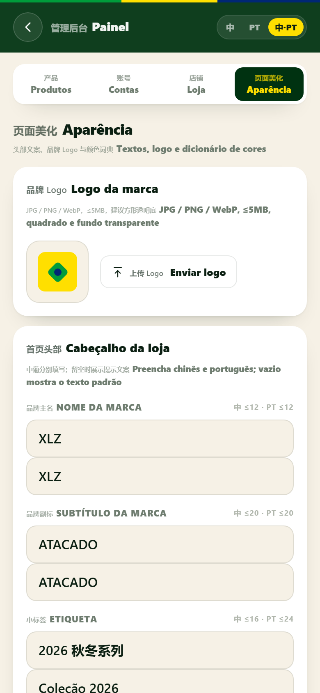
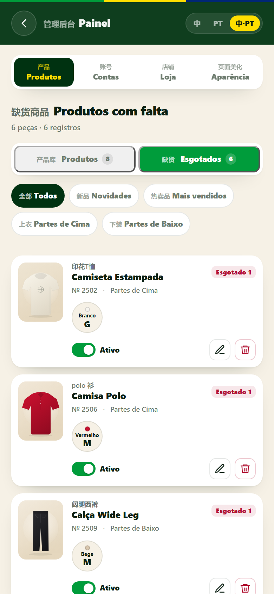

# XLZ 服装档口 · 产品展示

**线上地址：<https://xlz-showcase.wenkezhang995.workers.dev/>**

移动端优先的服装档口产品展示网页，依据《XLZ产品展示 · 项目需求文档》及《修改1》《修改2》《修改3》实现。配色取自巴西国旗：绿 `#009C3B`、黄 `#FFDF00`、蓝 `#002776`、白。


## 快速开始

- 线上直接打开：<https://xlz-showcase.wenkezhang995.workers.dev/>
- 本地双击 `public/index.html`（推荐 Chrome / Edge，390–430px 宽度最接近手机效果）。
- 访客无需登录即可浏览、搜索、切换语言、查看详情。
- 管理员入口在右上角「登录」或页脚「管理员登录」；初始账号密码见交付说明，未在登录页或仓库公开。

## 本次修改（修改3）

| 编号 | 需求 | 实现 |
| --- | --- | --- |
| S1 | 新增「页面美化」与品牌 Logo | 后台新增「页面美化」栏目；首页头部 5 个字段整体迁入；新增品牌 Logo 上传、替换、移除，应用于顶栏、页脚、登录页；未上传时回退默认图标 |
| S2 | 品类管理、筛选与缺货合并 | 产品分类从店铺迁到产品页「管理品类」面板；产品页新增「新品 / 热卖品」筛选；取消独立「缺货」栏目，改为产品库 / 缺货两个视图 |
| S3 | 缺货按产品归并 | 同一产品一张卡，卡内集中列出全部缺货颜色与尺码；同色尺码相邻；仍不显示价格、星标、新品，保留下架、编辑、删除 |
| S4 | 颜色词典迁移、取色与删除 | 词典迁入页面美化；新增/编辑颜色使用圆形色盘取色并写入 HEX；支持删除颜色，被产品使用的颜色禁止删除 |





## 修改2 能力（沿用）

- 详情图集为通用图 + 各颜色归属图的混合轮播；点选颜色定位到该色第一张图，无图时回退通用图。
- 缺货口径：任一颜色任一尺码缺货即计入（本轮改为按产品归并展示）。
- 底部 WhatsApp / TikTok / Instagram / Facebook 链接与二维码，空值不显示。
- 售价旁显示批发价，支持数字或「联系商家」；点击按钮滚动到联系信息区。

## 修改1 能力（沿用）

- 图片颜色归属、特殊标签、封面、前后排序；颜色词典中葡同步。
- 首页新品 / 热卖栏目；店铺头部 5 个字段可配；登录页不显示凭据。
- 后台品类筛选；旧数据自动迁移。

## 后台结构

后台共 4 个栏目：

| 栏目 | 内容 |
| --- | --- |
| 产品 | 产品库 / 缺货视图切换；新增产品、管理品类；全部 / 新品 / 热卖 / 品类筛选 |
| 账号 | 改密、新增、删除管理员 |
| 店铺 | 电话、地址、社交账号与二维码、数据备份 |
| 页面美化 | 品牌 Logo、首页头部 5 个字段、颜色词典 |

- **产品库**：价格、新品 / 星标开关、上下架、编辑、删除；缺货数量角标。
- **缺货视图**：按产品归并，卡内圆圈列出全部缺货颜色 × 尺码；无价格 / 星标 / 新品；保留下架、编辑、删除；不提供新增入口。
- **管理品类**：新增时分别填写中葡文（中文 ≤12、葡文 ≤20）；仍关联产品的品类删除按钮禁用。
- **页面美化**：Logo 支持 JPG / PNG / WebP ≤5MB，上传后立即用于顶栏、页脚、登录页；颜色词典可新增、编辑、删除，新增默认灰色，可用圆形色盘取色。

## 字段与字符限制

| 字段 | 限制 |
| --- | --- |
| 品牌主名 / 品牌副标 | 12 / 20 字符（中葡分别） |
| kicker / 主标题 / 副标题 | 16·24 / 20·30 / 40·60（中·葡） |
| 产品品名 / 型号 | 20·40 / 20 |
| 颜色标签 / 特殊标签 | 12·20（中·葡） |
| 联系电话 / 门店地址 | 20 / 60·80 |
| 批发价 | ≥ 0，最多两位小数；或「联系商家」 |
| 社交主页链接 / 二维码 | ≤200 / JPG·PNG·WebP ≤5MB |
| 品牌 Logo | JPG·PNG·WebP ≤5MB，建议方形透明底 |
| 品类名称 | 中文 ≤12，葡文 ≤20 |

超限会拦截保存并标红提示。

## 数据结构

```js
product.images    = [{ id, src, colorId, specialTags: [{ zh, pt }], isCover }]
product.colors    = [{ id, dictId, zh, pt, stock: { P: true, M: false } }]
product.wholesale = { type: 'price', value: 45.9 } | { type: 'contact', value: null }

settings.address  = { zh, pt }
settings.logo     = { src }            // 空字符串时回退默认图标
settings.brand / brandSub / kicker / heroTitle / heroSub = { zh, pt }
settings.social   = { whatsapp: { url, qr }, tiktok: { url, qr }, instagram: { url, qr }, facebook: { url, qr } }

colorDict = [{ id, zh, pt, hex }]      // hex 由色盘写入
cats      = [{ id, zh, pt }]
```

- 缺货条目由 `colors[].stock` 实时推导，不额外持久化。
- 旧数据迁移：现有头部文案、词典、品类原样保留；未上传 Logo 时回退默认图标。

## 文件结构

```
xlz-showcase/
├─ public/               部署目录（Cloudflare 输出）
│  ├─ index.html
│  ├─ styles.css
│  ├─ app.js
│  ├─ xlz-color-dict.js  28 个预置颜色
│  ├─ _headers
│  └─ 404.html
├─ preview/              页面预览图
├─ .gitignore
└─ README.md
```

## 线上部署与更新

线上使用 **Cloudflare Workers 静态资源（Workers Builds，连接 GitHub 自动部署）**：

| 环境 | 地址 |
| --- | --- |
| 生产 | <https://xlz-showcase.wenkezhang995.workers.dev/> |
| 预览 | `<版本前缀>-xlz-showcase.wenkezhang995.workers.dev`（每次推送变化，仅验收用） |

构建配置：Framework preset `None`，Build command `exit 0`，Build output directory `public`，Root `/`。

```bash
cd D:\deepseekworkzone\projects\xlz-showcase
# 修改 public/ 下文件
git add .
git commit -m "更新：说明本次改动"
git push
```

推送 `main` 后 Cloudflare 自动部署，约 1 分钟；生产地址不变。

> 商品数据保存在各浏览器 `localStorage`，不随代码同步；批量迁移用「店铺 → 数据备份 → 导出 / 导入」。

## 自检记录

无头 Chrome + CDP，390×844 手机视口实测：

- 后台 4 栏：产品 / 账号 / 店铺 / 页面美化；店铺不再包含头部、品类、词典；页面美化含 5 个头部字段、Logo、28 条词典。
- Logo 上传后顶栏、页脚、登录页均生效；移除后回退默认图标。
- 品类管理：超 12 字拦截；新增中葡品类并出现在筛选；未被使用的品类可删除；使用中的品类删除按钮禁用（2 个）。
- 产品筛选：新品 4、热卖 3、全部 8；缺货视图 7 张产品卡、9 个圆圈；多缺货产品一张卡内 3 个圆圈，顺序 `黑色 G / 黑色 GG / 白色 M`；无价格 / 星标 / 新品、无新增入口。
- 缺货视图支持新品与品类筛选；旧地址 `#/admin/stockout` 仍进入缺货视图。
- 色盘取色写入 `#a32b2b`；新增颜色 29 条后删除回 28；被使用的红色删除被拦截；编辑色值成功。
- 旧设置迁移后 Logo 为空、社交字段 4 个；360px 无横向溢出；控制台无报错、无失败请求。

## 已知边界

- **没有服务端**：数据存在浏览器 `localStorage`，管理员在 A 浏览器的修改不会同步到 B 浏览器；真实多用户货架需要后端（Cloudflare Workers + D1 + R2）。
- 管理员账号密码仅前端校验，不能作为真实权限边界；初始凭据不在页面与仓库公开。
- 图片与 Logo 存在 `localStorage`，空间约 5MB 级；清除浏览器数据会丢失内容。
- 以下待确认项采用保守处理：已被产品使用的颜色**禁止删除**；新品 / 热卖与品类筛选**单选互斥**（与主页一致）；同色多尺码用相邻圆圈展示；**favicon 不随 Logo 替换**。
- 本期不含下单、购物车、支付、库存数量管理。
