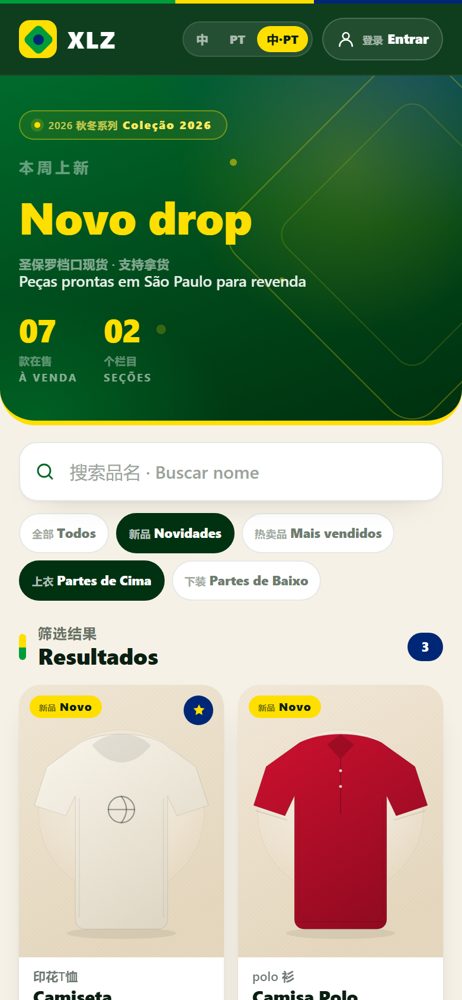
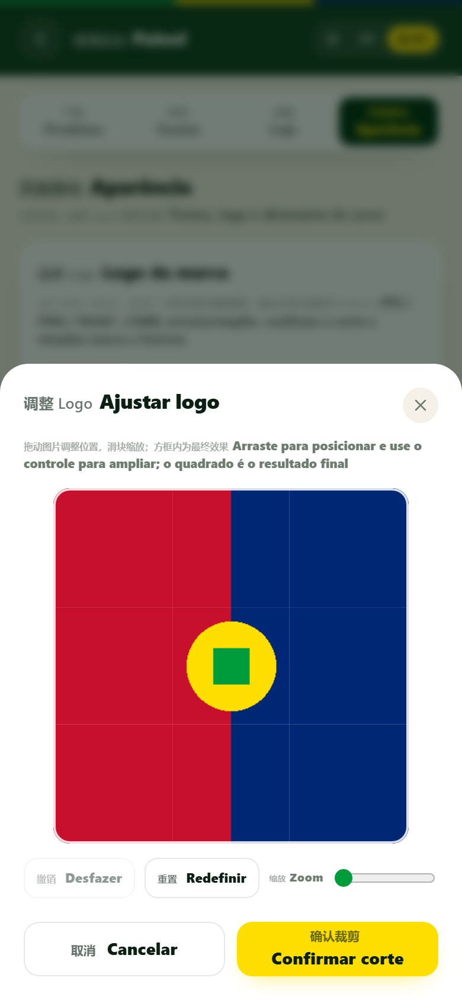

# XLZ 服装档口 · 产品展示

**线上地址：<https://xlz-showcase.wenkezhang995.workers.dev/>**

移动端优先的服装档口产品展示网页，依据《XLZ产品展示 · 项目需求文档》及《修改1》《修改2》《修改3》实现，并完成多选筛选与 Logo 裁剪升级。配色取自巴西国旗：绿 `#009C3B`、黄 `#FFDF00`、蓝 `#002776`、白。


## 快速开始

- 线上直接打开：<https://xlz-showcase.wenkezhang995.workers.dev/>
- 本地双击 `public/index.html`（推荐 Chrome / Edge，390–430px 宽度最接近手机效果）。
- 访客无需登录即可浏览、搜索、切换语言、查看详情。
- 管理员入口在右上角「登录」或页脚「管理员登录」；初始账号密码见交付说明，未在登录页或仓库公开。

## 本轮更新：多选筛选 + Logo 裁剪

**筛选**

- 主页与后台「产品」栏目的筛选标签均支持多选：可同时选多个品类，也可叠加「新品」「热卖品」。
- 多个品类之间取并集（产品属于任一已选品类），新品 / 热卖标记之间取交集（同时满足）。
- 最终结果为「品类条件」与「标记条件」的交集；再次点击已选标签取消该条件。
- 点击「全部」清空全部筛选，恢复完整列表。
- 主页与后台使用同一套匹配逻辑、选中态、计数与空结果提示；品类增删时筛选项同步更新。



**Logo 裁剪与 favicon**

- 选择图片后先进入裁剪界面：固定方形选框，可拖动图片、滑块缩放，方框内实时预览。
- 支持撤销上一步和重置到初始状态；未点「确认裁剪」前不会覆盖原 Logo。
- 确认后截取方形选区，输出 512×512 Logo 与 64×64 favicon。
- 裁剪图同时用于顶栏、页脚、登录页品牌位与浏览器 favicon；更换后 favicon 同步更新。
- 支持后续更换、移除；移除后品牌位与 favicon 回退默认图标。



## 修改3 能力（沿用）

| 编号 | 需求 | 实现 |
| --- | --- | --- |
| S1 | 新增「页面美化」与品牌 Logo | 首页头部 5 个字段、品牌 Logo、颜色词典集中到页面美化；Logo 应用于顶栏、页脚、登录页 |
| S2 | 品类管理、筛选与缺货合并 | 品类管理迁到产品页；产品页提供新品 / 热卖 / 品类筛选；取消独立缺货栏目，改为产品库 / 缺货视图 |
| S3 | 缺货按产品归并 | 同一产品一张卡，集中列出全部缺货颜色 × 尺码；不显示价格、星标、新品；保留下架、编辑、删除 |
| S4 | 颜色词典迁移、取色与删除 | 词典迁入页面美化；圆形色盘取色写入 HEX；支持删除，使用中的颜色禁止删除 |

## 修改2 / 修改1 能力（沿用）

- 图集为通用图 + 颜色归属图混合轮播，选色定位到该色第一张图。
- 底部 WhatsApp / TikTok / Instagram / Facebook 链接与二维码，空值不显示。
- 售价旁展示批发价，支持数字或「联系商家」并滚动到联系区。
- 图片颜色归属、特殊标签、封面、排序；颜色词典中葡同步。
- 店铺头部可配；后台账号、数据备份；旧数据自动迁移。

## 后台结构

后台共 4 个栏目：

| 栏目 | 内容 |
| --- | --- |
| 产品 | 产品库 / 缺货视图；新增产品、管理品类；多选筛选（全部 / 新品 / 热卖 / 品类） |
| 账号 | 改密、新增、删除管理员 |
| 店铺 | 电话、地址、社交账号与二维码、数据备份 |
| 页面美化 | 品牌 Logo（裁剪 / favicon）、首页头部 5 个字段、颜色词典 |

- **产品库**：价格、新品 / 星标开关、上下架、编辑、删除；缺货数量角标。
- **缺货视图**：按产品归并；无价格 / 星标 / 新品；保留下架、编辑、删除；无新增入口。
- **管理品类**：新增中葡品类（中文 ≤12、葡文 ≤20）；使用中的品类不可删除。
- **页面美化**：Logo 上传后先裁剪，确认才生效；颜色词典支持色盘取色与删除。

## 字段与字符限制

| 字段 | 限制 |
| --- | --- |
| 品牌主名 / 品牌副标 | 12 / 20 字符（中葡分别） |
| kicker / 主标题 / 副标题 | 16·24 / 20·30 / 40·60（中·葡） |
| 产品品名 / 型号 | 20·40 / 20 |
| 颜色标签 / 特殊标签 | 12·20（中·葡） |
| 联系电话 / 门店地址 | 20 / 60·80 |
| 批发价 | ≥ 0，最多两位小数；或「联系商家」 |
| 社交主页链接 / 二维码 | ≤200 / JPG·PNG·WebP ≤5MB |
| 品牌 Logo | JPG·PNG·WebP ≤5MB；裁剪输出 512×512 |
| 品类名称 | 中文 ≤12，葡文 ≤20 |

## 数据结构

```js
product.images    = [{ id, src, colorId, specialTags: [{ zh, pt }], isCover }]
product.colors    = [{ id, dictId, zh, pt, stock: { P: true, M: false } }]
product.wholesale = { type: 'price', value: 45.9 } | { type: 'contact', value: null }

settings.address  = { zh, pt }
settings.logo     = { src, fav }       // src 512×512，fav 64×64；空时回退默认
settings.brand / brandSub / kicker / heroTitle / heroSub = { zh, pt }
settings.social   = { whatsapp: { url, qr }, tiktok: { url, qr }, instagram: { url, qr }, facebook: { url, qr } }

colorDict = [{ id, zh, pt, hex }]
cats      = [{ id, zh, pt }]
```

- 缺货条目由 `colors[].stock` 实时推导，不额外持久化。
- 旧数据迁移：现有头部文案、词典、品类原样保留；无 Logo 时回退默认图标。

## 文件结构

```
xlz-showcase/
├─ public/               部署目录（Cloudflare 输出）
│  ├─ index.html
│  ├─ styles.css
│  ├─ app.js
│  ├─ xlz-color-dict.js  28 个预置颜色
│  ├─ _headers
│  └─ 404.html
├─ preview/              页面预览图
├─ .gitignore
└─ README.md
```

## 线上部署与更新

线上使用 **Cloudflare Workers 静态资源（Workers Builds，连接 GitHub 自动部署）**：

| 环境 | 地址 |
| --- | --- |
| 生产 | <https://xlz-showcase.wenkezhang995.workers.dev/> |
| 预览 | `<版本前缀>-xlz-showcase.wenkezhang995.workers.dev`（每次推送变化，仅验收用） |

构建配置：Framework preset `None`，Build command `exit 0`，Build output directory `public`，Root `/`。

```bash
cd D:\deepseekworkzone\projects\xlz-showcase
# 修改 public/ 下文件
git add .
git commit -m "更新：说明本次改动"
git push
```

推送 `main` 后 Cloudflare 自动部署，约 1 分钟；生产地址不变。

> 商品数据保存在各浏览器 `localStorage`，不随代码同步；批量迁移用「店铺 → 数据备份 → 导出 / 导入」。

## 自检记录

无头 Chrome + CDP，390×844 手机视口实测：

**多选筛选**

- 主页初始 5 个标签、仅「全部」选中、7 款在售；新品 4、热卖 3。
- 新品 + 热卖交集 1；再叠加「上衣」仍 1；上衣 + 下装并集 7；「全部」清空恢复 7。
- 临时空品类显示统一空结果提示与「清空筛选」，清空后恢复。
- 后台 6 个标签（含临时品类）、8 款产品；新品 + 热卖 + 下装为 0，头部计数 0；空结果提示与主页一致。
- 品类新增后标签 +1；删除被选中的品类后标签 -1、选中条件清除并恢复全部。
- 缺货视图多选（新品 + 上衣）得到 2 款；清空后 6 款。

**Logo 裁剪 / favicon**

- 裁剪框 300×300；选择文件后、确认前 `settings.logo.src` 仍为空。
- 缩放 600→960→撤销 600；拖动 -150→-110→撤销 -150；重置后滑块 100、撤销禁用。
- 确认后 Logo 512×512、favicon 64×64；`favicon` href 等于新 favicon；顶栏、页脚、登录页均生效。
- 再次上传后取消，原 Logo 不变；移除后 `settings.logo` 为空、favicon 回退默认、品牌位回退默认图标。
- 360px 无横向溢出；控制台无报错、无失败请求。

## 已知边界

- **没有服务端**：数据存在浏览器 `localStorage`，管理员在 A 浏览器的修改不会同步到 B 浏览器；真实多用户货架需要后端（Cloudflare Workers + D1 + R2）。
- 管理员账号密码仅前端校验，不能作为真实权限边界；初始凭据不在页面与仓库公开。
- 图片、Logo 与 favicon 存在 `localStorage`，空间约 5MB 级；清除浏览器数据会丢失内容。
- 筛选语义：多个品类取并集，新品 / 热卖取交集，再与品类取交集；主页与后台各自保留当前筛选状态，但匹配与提示逻辑一致。
- 待确认项处理：已被产品使用的颜色禁止删除；同色多尺码用相邻圆圈展示。
- 本期不含下单、购物车、支付、库存数量管理。
